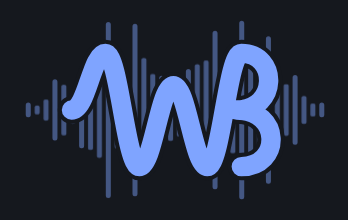
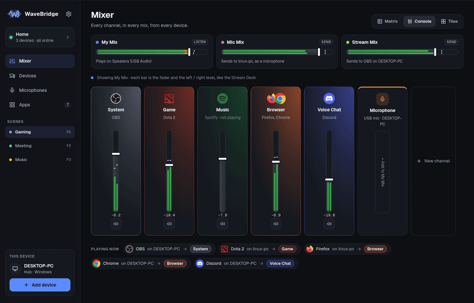
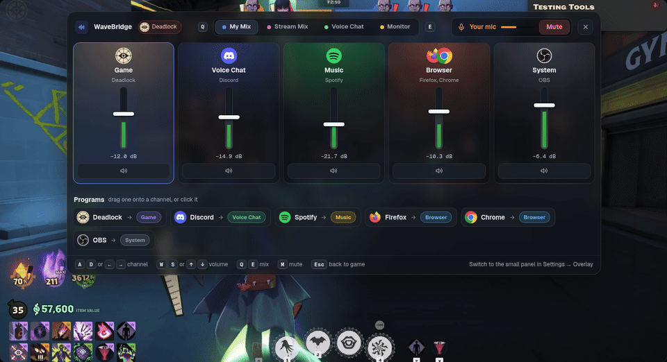
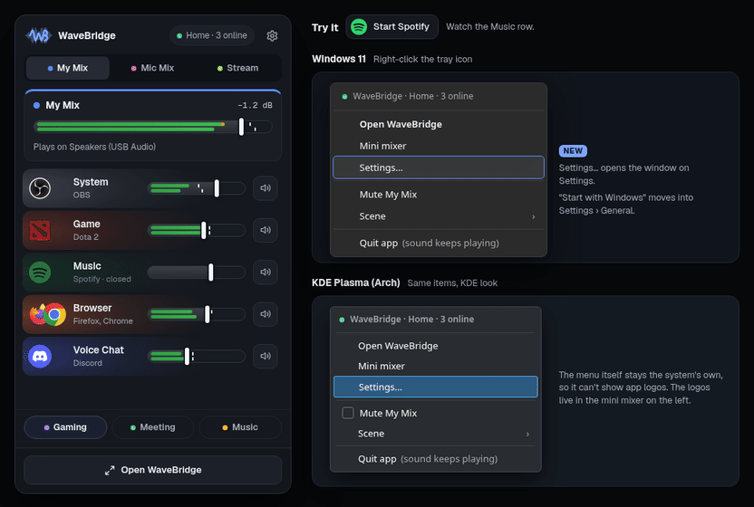
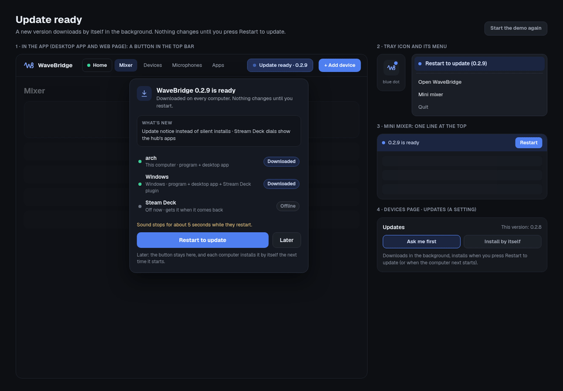

  

<h1 align="center">WaveBridge</h1>

  One sound mixer for every computer and phone in your home. 
  Low-latency audio and microphones over your local network, a Wave Link–style mixer, and a game overlay.

  <a href="https://github.com/Hameed-Alahmadi/wavebridge-releases/releases/latest"><b>Download the latest release</b></a>
  · Linux · Windows · Steam Deck · Android · Stream Deck

---

## The mixer

Every app lands on its own channel (Game, Voice Chat, Music, Browser, System), and each channel
takes the logo and colour of the apps playing on it. Each mix (My Mix, Stream Mix, Voice Chat,
Monitor) has its own fader and mute per channel, with live left/right meters.

## Game overlay

Press **Ctrl+Alt+W** in a game to open the mixer on top of it, without alt-tabbing.

- **A / D** or **← →** pick a channel, **W / S** or **↑ ↓** change its volume
- **Q / E** switch between mixes, **M** mutes the channel, **Esc** goes back to the game
- Drag a program onto a channel (or click it) to move its sound there
- **Ctrl+Alt+M** mutes your microphone anytime; a small "Mic muted" pill stays on screen
- Wide strip or a small corner panel, both see-through (Settings → Game overlay)

## Tray and mini mixer

The tray icon opens a mini mixer with the same channels, logos and meters, plus quick access to
Settings.

## Updates that ask first

New versions download by themselves in the background on every computer. Nothing changes until
you press **Restart to update**, from the app, the tray or the mini mixer. Each release is signed,
and every computer checks the signature before installing it.

## What else it does

- **Streams audio between devices** on your local network with low latency, without drops or
  clicks when clocks drift apart.
- **Shares microphones**: every mic becomes a channel in **Mic Mix**, which any computer can use as
  its microphone (Discord, games, OBS).
- **Cleans up your voice**: high-pass, hum removal, EQ, gate, compressor, limiter and optional
  RNNoise noise removal.
- **Remembers where apps go**: move a program to a channel once and it lands there every time it
  starts.
- **Control from anywhere**: every device serves the same page, so a phone or another computer can
  run the mixer.
- **Stream Deck plugin**: faders, mutes and dials for every channel, with the apps' logos.

## Download

Get the files from the [latest release](https://github.com/Hameed-Alahmadi/wavebridge-releases/releases/latest):

| File | For |
|---|---|
| `wavebridge-app-windows-x86_64.exe` | Windows: the desktop app (mixer, tray, overlay) |
| `wavebridge-windows-x86_64.exe` | Windows: the background program alone |
| `wavebridge-app-linux-x86_64` | Linux and Steam Deck: the desktop app |
| `wavebridge-linux-x86_64` | Linux and Steam Deck: the background program alone |
| `wavebridge-android.apk` | Android phones |
| `streamdeck-plugin.zip` | Elgato Stream Deck plugin |
| `manifest.json` | Signed list of the files and their SHA-256 (used by the updater) |

Once installed, WaveBridge updates itself from this page.

**Windows:** to give apps a WaveBridge microphone, install the free
[VB-Cable](https://vb-audio.com/Cable/) (run `VBCABLE_Setup_x64.exe` as administrator, then
restart). WaveBridge finds the cable by itself; in Discord or a game pick **CABLE Output** as the
microphone.

## License

© 2026 Abdulhameed Alahmadi. All rights reserved. WaveBridge is free to download and use; the
source code is not published. See [LICENSE](LICENSE), and
[THIRD-PARTY-NOTICES](THIRD-PARTY-NOTICES.md) for the open-source components inside it.
